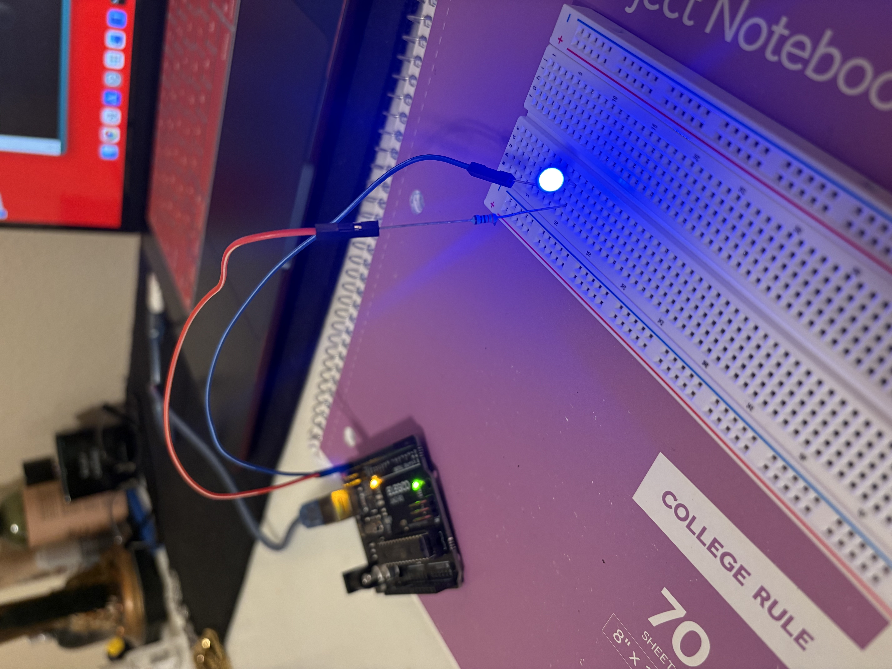

# Project 01 - External LED Blink

**Date: November 24, 2026**

## Objective

Build my first external LED circuit using an Arduino
Uno R3 and control it through C++ programming.

## Components Used

- Arduino Uno R3
- LED
- Breadboard
- 330 Ω resistor
- Two female-to-male jumper wires

## Concepts Learned

### LED Polarity
- Long leg (+): Anode
- Short leg (-): Cathode
- Current must flow through the LED in the correct direction.

### Resistors
- Resistors limit electrical current.
- A 220–330 Ω resistor is suitable for this circuit.
- Resistors are not polarized, so either orientation works.

### Jumper Wires
- Female connectors have a socket.
- Male connectors have an exposed pin.
- Wire color does not affect electrical functionality.

### Breadboard
- Certain holes are internally connected.
- B10 and D10 are electrically connected on my breadboard.

## Circuit Assembly

### Step 1
- Connect the blue jumper wire to GND.
- Connect the red jumper wire to digital pin 13.

### Step 2
- Insert one leg of the resistor into the female
  connector of the red jumper wire.
- Leave the other resistor leg exposed.

### Step 3
- Connect the cathode of the LED to the female
  connector of the blue jumper wire.
- Leave the anode exposed.

### Step 4
- Insert the exposed resistor leg into B10.
- Insert the LED anode into D10.
- These breadboard connections complete the circuit.

### Step 5
- Upload the C++ program to the Arduino Uno R3.
- Observe the external LED blinking.

## Circuit Path

Pin 13 → 330 Ω Resistor → LED → GND

## Source Code

[View my C++ program](01_External_LED_Blink.ino)

## Project Photograph

## Result

Successfully built and programmed my first external
LED circuit using the Arduino Uno R3!

Can't wait to see what comes next :) 
